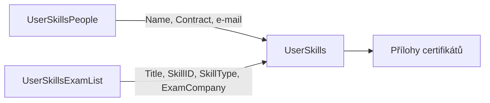

# Technická dokumentace projektu Certifikace

## Přehled řešení

Aplikace slouží k evidenci zaměstnaneckých certifikací. Data jsou uložena v SharePoint Online a uživatelské rozhraní je vytvořeno v Microsoft Power Apps. V aktuální verzi řešení není použito workflow.

## Použité SharePoint listy

| List | Účel |
|---|---|
| `UserSkills` | Evidence certifikátů zaměstnanců včetně příloh |
| `UserSkillsPeople` | Číselník zaměstnanců |
| `UserSkillsExamList` | Číselník zkoušek a certifikací |

## UserSkills

Hlavní seznam obsahující certifikace přiřazené zaměstnancům. K jednotlivým záznamům lze ukládat přílohy s certifikáty.

| Sloupec | Typ | Použití v Power Apps |
|---|---|---|
| `Title` | Single line of text | Hodnota z `UserSkillsExamList.Title`, název zkoušky nebo certifikace |
| `Name` | Single line of text | Hodnota z `UserSkillsPeople.Name` |
| `Microsoft Account (MSA)` | Single line of text | Hodnota z `UserSkillsPeople.MicrosoftCertEmail` |
| `MCID` | Number | Identifikátor Microsoft Certification ID |
| `Skill ID` | Single line of text | Hodnota z `UserSkillsExamList.SkillID` |
| `Skill Completion Date` | Date and Time | Datum získání certifikace |
| `Relevant for Competencies (Option) or Programs` | Multiple lines of text | Hodnota z `UserSkillsExamList.RelevantForCompetencies` |
| `Skill Expiration Date` | Date and Time | Datum expirace certifikace |
| `ADEmail` | Single line of text | E-mail uživatele z Active Directory |
| `Contract` | Single line of text | Hodnota z `UserSkillsPeople.Contract` |
| `SkillType` | Single line of text | Typ záznamu z číselníku zkoušek |
| `Skill Status` | Calculated | Vypočtený stav certifikace |
| `ExamCompany` | Single line of text | Hodnota z `UserSkillsExamList.ExamCompany` |
| `Attachments` | Attachments | Příloha s certifikátem, povinná při založení záznamu |

## UserSkillsPeople

Číselník zaměstnanců používaný při výběru osoby v aplikaci.

| Sloupec | Typ | Popis |
|---|---|---|
| `Name` | Single line of text | Jméno a příjmení zaměstnance |
| `Contract` | Choice | Typ nebo stav spolupráce, například external, internal, neaktivní nebo aktivní |
| `PersonName` | Person or Group | Osoba z Active Directory |
| `ADEmail` | Single line of text | E-mail z Active Directory |
| `MicrosoftCertEmail` | Single line of text | E-mail použitý pro registraci u Microsoftu |
| `Country` | Choice | Země, například CZ nebo SK |
| `BU` | Choice | Business unit |
| `Unit` | Choice | Organizační jednotka |

## UserSkillsExamList

Číselník zkoušek a certifikací.

| Sloupec | Typ | Popis |
|---|---|---|
| `Title` | Single line of text | Název certifikace nebo zkoušky |
| `SkillID` | Single line of text | Krátké označení, například `PL-100` |
| `SkillType` | Choice | Certifikace, exam nebo assessment |
| `RelevantForCompetencies` | Multiple lines of text | Popis certifikace a její relevance |
| `ExamCompany` | Choice | Společnost, která certifikaci vydala |

## Vazby mezi listy

`UserSkills` je hlavní transakční seznam. Údaje o zaměstnanci se vybírají z `UserSkillsPeople` a údaje o certifikaci z `UserSkillsExamList`. Aplikace následně ukládá vybrané hodnoty do záznamu certifikace.

## Power Apps

### Hlavní obrazovka

Hlavní obrazovka zobrazuje seznam certifikací a umožňuje jednoduché i kombinované filtrování.

Dostupné filtry:

- **Skill ID**: krátké označení certifikace od vydavatele,
- **Name**: zaměstnanec načtený z číselníku `UserSkillsPeople`,
- **Exam company**: společnost, která certifikát vydala,
- **Search**: vyhledávání v názvu certifikace.

Výchozí filtr je nastaven na filtrování zaměstnanců.

Na hlavní obrazovce jsou také administrátorská tlačítka **Name** a **Skill**. Běžní uživatelé je nevidí. Administrátor přes ně může doplnit zaměstnance nebo certifikaci přímo do příslušného číselníku.

Ikona `+` otevře formulář pro vložení nové certifikace zaměstnance.

### Přílohy

Ikona přílohy označuje, že je k záznamu přiložen jeden nebo více souborů. Po najetí myší se uživateli zobrazí název přiloženého certifikátu.

### Formulář pro přidání certifikace

Formulář se otevře po kliknutí na ikonu `+`.

Povinná pole:

- `Name`,
- `Skill ID`,
- `Attachments`.

Bez vyplnění těchto polí nelze formulář uložit. Pole `Name` je založeno na textové hodnotě, aby bylo možné evidovat i osoby, které nejsou dostupné v Active Directory.

Formulář obsahuje také tlačítka pro doplnění chybějící osoby nebo certifikace do číselníků.

### Formulář New name

Tlačítko **New name** otevře formulář pro založení nového zaměstnance. Uživatel zadává zejména jméno, typ kontraktu a zemi. Po uložení se vrátí zpět do formuláře nové certifikace.

### Formulář New exam

Tlačítko **New exam** otevře formulář pro založení nové zkoušky nebo certifikace.

Zadávají se zejména:

- `SkillID`, například `PL-100`,
- `SkillType`,
- povinný `Title`,
- `RelevantForCompetencies`,
- vydávající společnost.

Po uložení zůstává uživatel ve formuláři pro přidání certifikace.

## Role a oprávnění

Běžný uživatel může:

- prohlížet a filtrovat záznamy,
- vložit novou certifikaci,
- přiložit soubor s certifikátem.

Administrátor navíc může:

- přidávat zaměstnance do `UserSkillsPeople`,
- přidávat zkoušky a certifikace do `UserSkillsExamList`,
- používat administrátorská tlačítka na hlavní obrazovce.

## Poznámky k implementaci

- Řešení nepoužívá workflow.
- Hodnoty z číselníků jsou při ukládání propsány do hlavního seznamu `UserSkills`.
- Příloha je součástí záznamu certifikace a je při založení povinná.
- Citlivé adresy, identifikátory aplikace a tenant údaje jsou v portfoliu anonymizovány.
