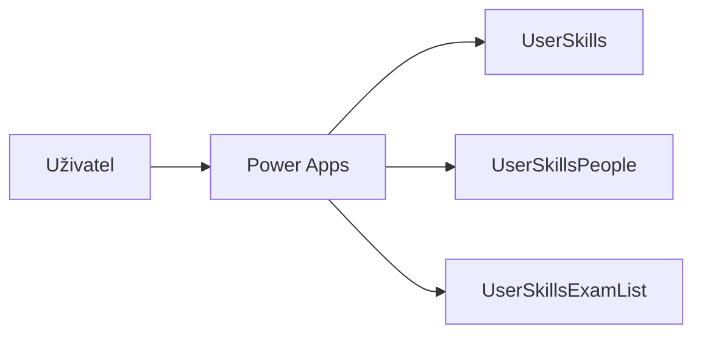
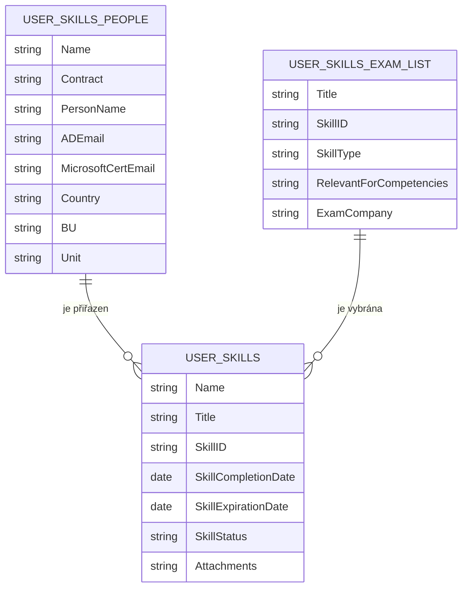
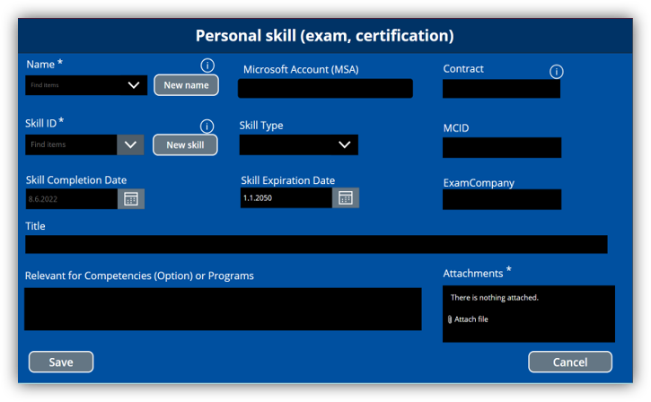
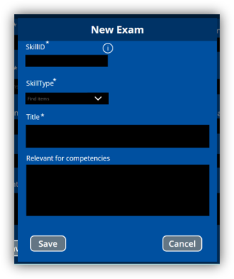
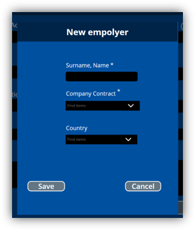
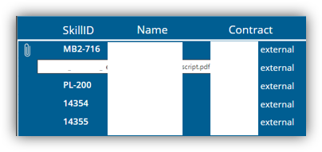

# Certifikace

## Přehled

Interní aplikace pro evidenci zaměstnaneckých certifikací. Řešení propojuje evidenci certifikátů zaměstnanců s číselníkem zaměstnanců a číselníkem zkoušek a certifikací.

## Účel řešení

- centralizovat evidenci certifikací zaměstnanců,
- umožnit filtrování a rychlé vyhledávání,
- zjednodušit zakládání certifikací,
- umožnit správcům doplňovat zaměstnance a zkoušky do číselníků,
- ukládat přílohy s certifikáty.

## Navržené řešení

Aplikace v Microsoft Power Apps pracuje se třemi SharePoint Online seznamy. Hlavní seznam obsahuje certifikace zaměstnanců, další dva seznamy slouží jako číselníky zaměstnanců a zkoušek. V aktuální verzi řešení není použito workflow.

## Použité technologie

- Microsoft Power Apps
- SharePoint Online

## Architektura

## Datový model

`UserSkills` je hlavní seznam certifikací zaměstnanců. Údaje o zaměstnanci přebírá z `UserSkillsPeople` a údaje o zkoušce nebo certifikaci z `UserSkillsExamList`.

## Hlavní funkce

- přehled certifikací,
- jednoduché i kombinované filtrování,
- vyhledávání podle názvu certifikace,
- založení nové certifikace zaměstnance,
- přiložení souboru s certifikátem,
- založení zaměstnance administrátorem,
- založení zkoušky nebo certifikace administrátorem.

## Přístup a oprávnění

Přístup k datům a jednotlivým funkcím je řízen oprávněními SharePointu nad příslušnými seznamy. Administrátorské funkce aplikace jsou dostupné pouze oprávněným uživatelům.

## Moje role

- analýza business požadavků,
- návrh datového modelu,
- návrh architektury řešení,
- vývoj aplikace v Power Apps,
- návrh SharePoint seznamů,
- testování a dokumentace.

## Galerie

### Přehled certifikací

### Formulář certifikace

### Nová zkouška nebo certifikace

### Nový zaměstnanec

### Přehled příloh

## Dokumentace

Podrobnosti jsou ve složce [Dokumentace](Dokumentace/).
