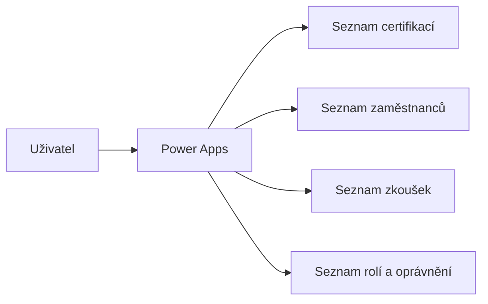
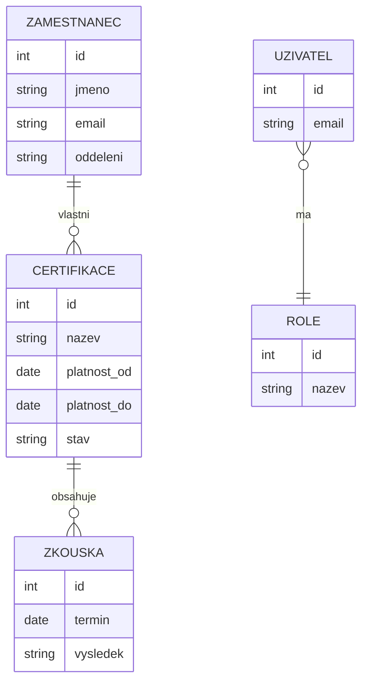

# Certifikace

## Přehled

Interní aplikace pro evidenci zaměstnaneckých certifikací, zkoušek a souvisejících uživatelských oprávnění. Řešení centralizuje data, omezuje ruční práci a poskytuje přehled o platnosti certifikací.

## Business problém

Evidence certifikací byla roztříštěná mezi více zdrojů a její aktualizace vyžadovala ruční kontrolu. Chyběl jednotný pohled na zaměstnance, certifikace, termíny zkoušek a stav platnosti.

## Cíle řešení

- centralizovat evidenci certifikací,
- zjednodušit zakládání a úpravu záznamů,
- umožnit filtrování a rychlé vyhledávání,
- omezit chybovost při ruční správě dat,
- připravit řešení pro další automatizaci upozornění a reportingu.

## Navržené řešení

Aplikace v Microsoft Power Apps pracuje s daty uloženými v SharePoint Online. Uživatelské rozhraní umožňuje správu zaměstnanců, certifikací a zkoušek. Přístup k funkcím je řízen podle role uživatele.

## Použité technologie

- Microsoft Power Apps
- SharePoint Online
- Microsoft Lists
- Microsoft 365

## Architektura

## Datový model

## Hlavní funkce

- přehled certifikací,
- filtrování a vyhledávání,
- založení nové certifikace,
- založení zaměstnance,
- evidence zkoušek,
- editace existujících záznamů,
- řízení přístupu podle role.

## Moje role

- analýza business požadavků,
- návrh datového modelu,
- návrh architektury řešení,
- vývoj aplikace v Power Apps,
- návrh SharePoint seznamů,
- testování a dokumentace.

## Galerie

Obrázky budou uloženy ve složce [Images](Images/).

Plánované soubory:

- `architecture.png`
- `home-screen.png`
- `filter.png`
- `new-certificate.png`
- `new-user.png`
- `new-exam.png`
- `edit-certificate.png`
- `sharepoint-lists.png`

## Dokumentace

Podrobnosti jsou ve složce [Dokumentace](Dokumentace/).

## Analýza

Business a funkční analýza je ve složce [Analyza](Analyza/).
