# Digitální podpis

## Přehled

Pilotní řešení pro elektronické podepisování firemních dokumentů. Propojuje SharePoint Online, Power Automate a službu DigiSign prostřednictvím REST API. Uživatel vybere dokument v knihovně SharePointu, automatizace připraví podpisovou obálku pro dva podepisující, odešle jim výzvu a po dokončení uloží podepsaný dokument společně s auditním záznamem.

Řešení vzniklo proto, že firma potřebovala elektronicky podepisovat dokumenty a neměla pro tento účel jiný nástroj ani integrační proces.

> Dokumentace byla anonymizována pro účely veřejného portfolia. DigiSign je použitý poskytovatel podpisové služby; zobrazené jméno autorky je ponecháno záměrně.

## Cíl pilotu

- umožnit elektronické podepsání dokumentu dvěma příjemci,
- spustit celý proces přímo nad vybraným souborem v SharePointu,
- automatizovat komunikaci s podpisovou službou přes API,
- sledovat stav podpisové obálky bez ruční kontroly,
- uložit podepsané dokumenty a auditní log zpět do SharePointu,
- ověřit architekturu, kterou lze později rozšířit o další příjemce.

## Použité technologie

- Microsoft SharePoint Online
- Microsoft Power Automate
- DigiSign REST API
- HTTP / JSON
- práce se soubory ve formátu Base64
- Microsoft Word a PDF

## Architektura řešení

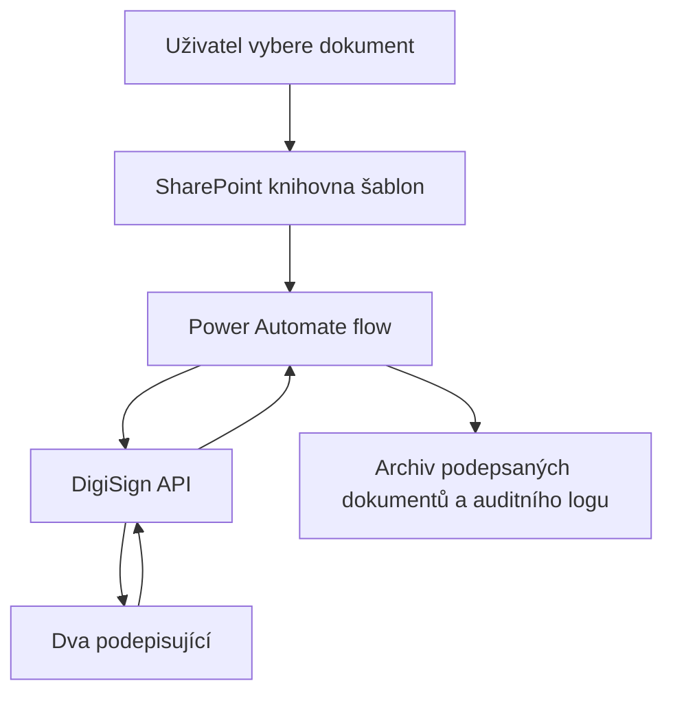

SharePoint slouží jako pracovní prostředí a úložiště dokumentů. Power Automate řídí celý proces a prostřednictvím HTTP požadavků komunikuje s DigiSign API. DigiSign zajišťuje doručení výzev, ověření podepisujících, samotný podpis a auditní stopu.

## Průběh automatizace

1. Uživatel vybere připravený dokument v knihovně šablon a spustí akci **DigiSign for selected item**.
2. Flow načte metadata a obsah souboru a připraví jej ve formátu Base64.
3. Pomocí autentizačního požadavku získá přístupový token pro DigiSign API.
4. V DigiSignu vytvoří novou podpisovou obálku.
5. Nahraje soubor a přidá jej do vytvořené obálky.
6. Doplní dva příjemce a přiřadí jim roli podepisujícího.
7. Umístí podpisová pole podle placeholderů v dokumentu.
8. Odešle obálku k podpisu.
9. Automatizace průběžně ověřuje stav obálky a pokračuje až po dokončení obou podpisů.
10. Stáhne výsledný balíček, rozbalí jej a uloží podepsaný dokument i auditní log do cílových knihoven.

## Příprava dokumentu

Šablona obsahuje placeholdery, podle kterých automatizace určí umístění podpisů:

```text
[podpis-Recipient1]
[podpis-Recipient2]
```

Pilot počítal se dvěma podepisujícími, protože více příjemců nebylo v daném scénáři potřeba. Datová struktura i jednotlivé API kroky však umožňují řešení rozšířit o další příjemce a podpisová pole.

## Organizace dokumentů v SharePointu

- **Template library** – vstupní Word nebo PDF šablony a metadata příjemců.
- **Pomocná knihovna pro převod** – dočasné uložení při převodu dokumentu z Wordu do PDF.
- **Knihovna stažených balíčků** – ZIP soubory vrácené podpisovou službou.
- **Finální knihovna** – rozbalené podepsané dokumenty a auditní záznamy.

## Uživatelský průchod

Podepisující obdrží e-mail s odkazem na dokument. Po otevření projde ověřením pomocí SMS kódu, zkontroluje dokument, potvrdí podpisová pole a dokončí podepsání. Po úspěšném dokončení obdrží potvrzení a může si stáhnout podepsané dokumenty. Součástí výsledku je auditní log zachycující průběh podpisového procesu.

### Výzva k podpisu


### Ověření podepisujícího

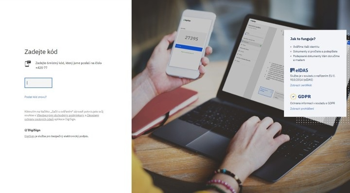

### Dokument s podpisovými poli

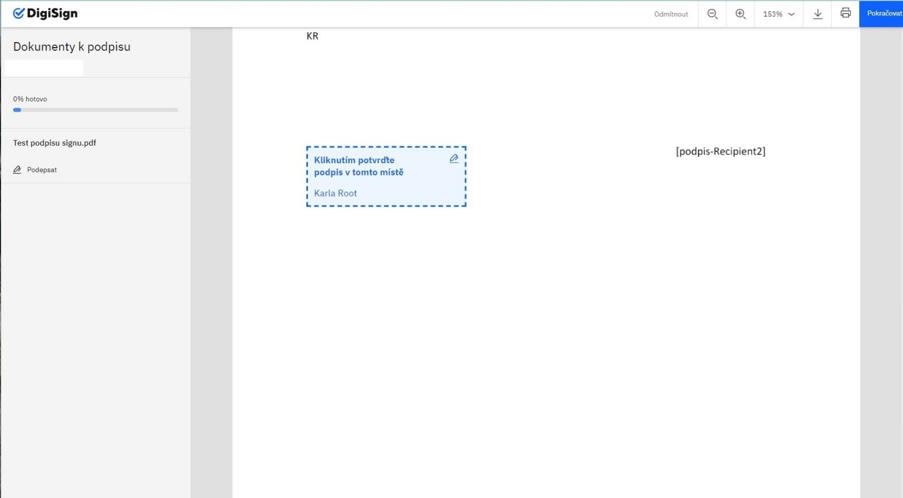

### Potvrzení podpisu

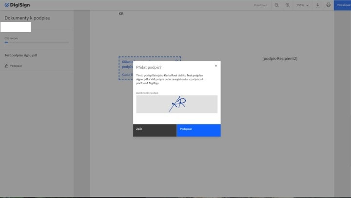

### Dokončený proces

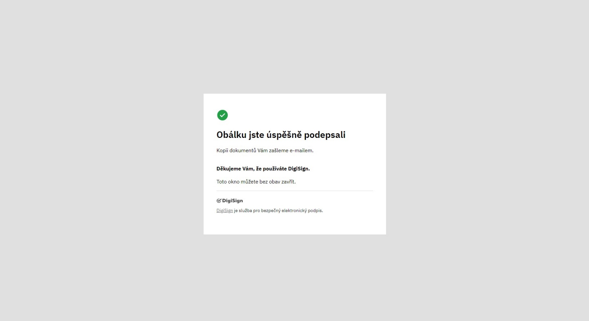

### Auditní stopa

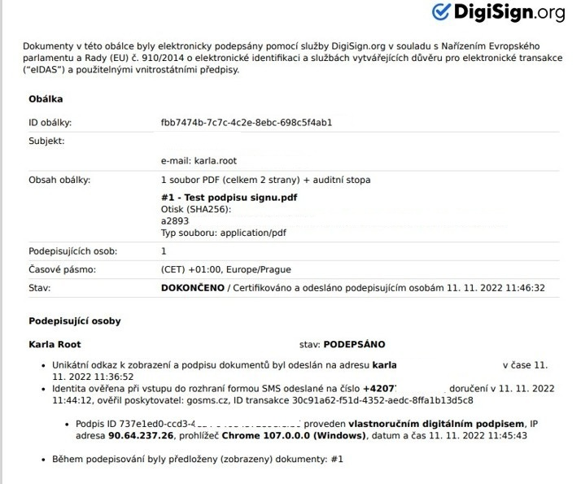

## Technická implementace

Integrace je sestavena z navazujících HTTP akcí v Power Automate. Každý krok využívá identifikátory vrácené předchozí akcí – zejména ID obálky, dokumentu a příjemců. Autentizace probíhá pomocí Bearer tokenu. Tělo požadavků je předáváno jako JSON a binární obsah dokumentu je zpracován v Base64.

### Vytvoření podpisové obálky

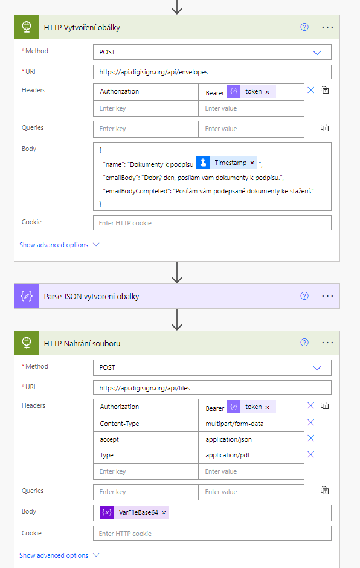

### Nahrání dokumentu

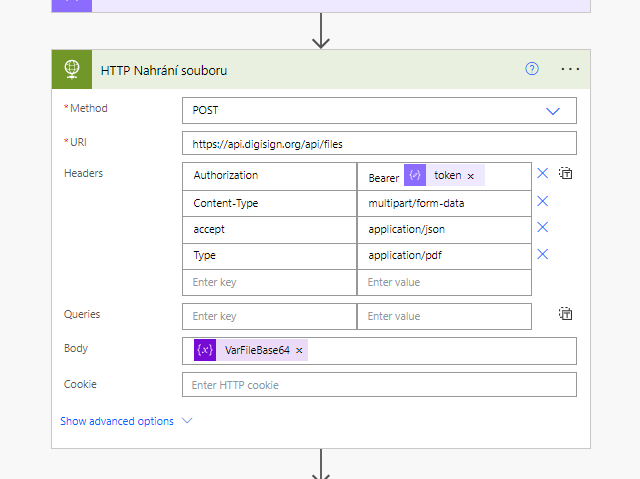

### Přidání příjemců

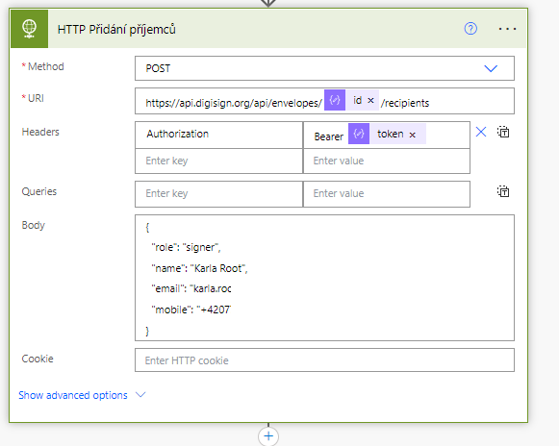

### Umístění podpisových polí

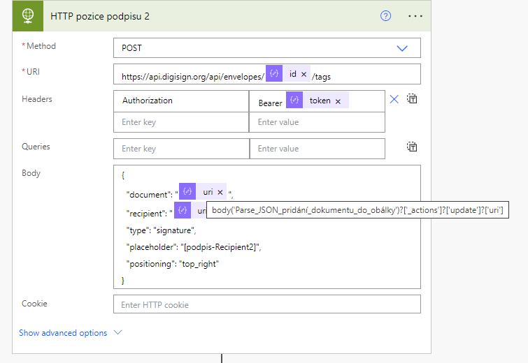

### Stažení výsledných dokumentů

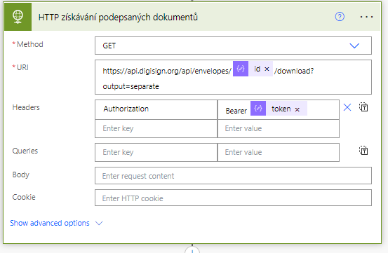

## Řízení stavu a chybové scénáře

Klíčovou součástí návrhu je čekání na stav dokončené obálky. Výstupní složky a finální dokumenty se vytvářejí až po dokončení podpisu oběma příjemci. Tím se zabraňuje tomu, aby byl neúplný dokument považován za finální výstup. Prodleva mezi odesláním a archivací je očekávaná a závisí na rychlosti podpisu příjemců.

Při produkčním rozšíření by bylo vhodné dále standardizovat zpracování odmítnutých a expirovaných obálek, opakování neúspěšných API volání, provozní notifikace a bezpečnou správu přístupových údajů.

## Výsledek

Pilot prokázal, že lze celý podpisový cyklus řídit z prostředí Microsoft 365 bez ručního přenášení dokumentů mezi SharePointem a podpisovou službou. Firma díky řešení získala funkční možnost elektronického podepisování dokumentů, kterou předtím neměla.

## Moje role

Řešení jsem vytvořila samostatně v celém rozsahu:

- analýza potřeby a návrh procesu,
- návrh architektury a organizace SharePoint knihoven,
- příprava šablon a placeholderů,
- vývoj Power Automate flow,
- integrace DigiSign REST API,
- autentizace, práce s JSON a Base64,
- návrh stavové logiky,
- testování uživatelského i technického průchodu,
- příprava uživatelské a administrátorské dokumentace.

## Poznámka k portfoliu

Projekt dokumentuje pilotní implementaci a technický princip řešení. Neobsahuje přístupové tokeny, plné interní adresy, názvy organizace ani produkční data.
