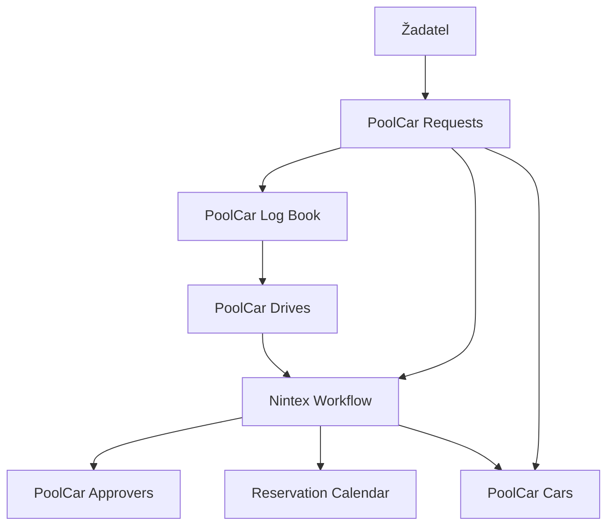
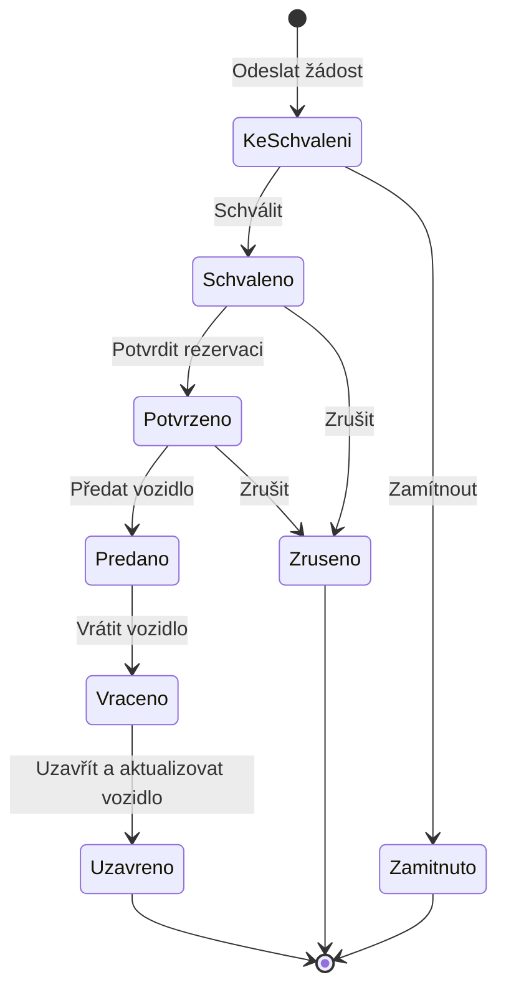

# PoolCar

## Přehled

Interní aplikace pro rezervaci služebních vozidel a správu navazující evidence jízd. Řešení centralizuje žádosti, schvalování, dostupnost vozidel, kalendář rezervací, knihy jízd i aktuální technické údaje o vozovém parku.

Aplikace vznikla na platformě SharePoint 2016 s využitím Nintex Forms a Nintex Workflow. Propojuje šest SharePoint seznamů a pět workflow do jednoho procesu od žádosti o vozidlo až po jeho vrácení a aktualizaci provozních údajů.

> Dokumentace byla anonymizována pro účely veřejného portfolia. Názvy organizace, interní adresy a produkční údaje nejsou zveřejněny.

## Řešený problém

Rezervace, schvalování a provozní evidence služebních vozidel vyžadovaly jednotné místo, ve kterém bude možné:

- zjistit aktuální dostupnost vozidel,
- zabránit souběžným rezervacím stejného automobilu,
- dohledat stav a historii žádosti,
- řídit schválení služební cesty,
- evidovat skutečné jízdy, tankování a nájezd kilometrů,
- po vrácení aktualizovat stav vozidla.

## Rozsah řešení

- **6 SharePoint seznamů** pro žádosti, vozidla, rezervace, knihy jízd, jednotlivé jízdy a schvalovatele,
- **5 Nintex workflow** pro identifikátory, schvalování, stavové přechody a agregace,
- **4 části hlavního formuláře** podle fáze procesu a role uživatele,
- **9 kontextových tlačítek** řízených stavem žádosti,
- evidence služebních i soukromých kilometrů, tankování, tachometru, nádrže a poškození.

## Použité technologie

- Microsoft SharePoint 2016
- Nintex Forms
- Nintex Workflow
- SharePoint seznamy, lookup pole a vypočítané hodnoty

## Architektura

Hlavním procesním záznamem je žádost v `PoolCar Requests`. Workflow řídí její identifikaci, schválení, rezervaci automobilu a změny stavu. Po skončení cesty na žádost navazuje kniha jízd a jednotlivé jízdy. Souhrnné hodnoty se následně propisují zpět do evidence vozidla.

## Datové části

| Seznam | Odpovědnost |
|---|---|
| `PoolCar Requests` | Žádost, schvalování, průběh rezervace a shrnutí cesty |
| `PoolCar Cars` | Vozový park, dostupnost a aktuální provozní údaje |
| `PoolCar Reservation Calendar` | Aktivní, historické a zrušené rezervace |
| `PoolCar Log Book` | Souhrnná kniha jízd k jedné žádosti |
| `PoolCar Drives` | Jednotlivé jízdy, kilometry, tankování a účel cesty |
| `PoolCar Approvers` | Číselník oprávněných schvalovatelů |

## Hlavní proces

Viditelnost formulářových částí a tlačítek se mění podle stavu žádosti a role uživatele. Tím aplikace vede uživatele procesem a omezuje operace, které v dané fázi nejsou přípustné.

## Automatizace

### Založení a schválení žádosti

Po vytvoření žádosti workflow přidělí identifikátor, nastaví stav `Ke schválení`, odešle notifikaci a vytvoří úkol pro schvalovatele. Výsledek schválení se zapíše do stavu žádosti a je oznámen zúčastněným osobám.

### Rezervace vozidla

Po potvrzení schválené žádosti vytvoří workflow záznam v rezervačním kalendáři. Rezervované vozidlo není dostupné pro další rezervaci. Při změně automobilu se porovná původní hodnota uložená v pomocném poli a proces přejde do odpovídajícího stavu.

### Vrácení a uzavření

Po vrácení se rezervace uvolní v kalendáři. Při uzavření workflow aktualizuje tachometr, stav nádrže a evidované poškození v seznamu vozidel.

### Kniha jízd

Ke vrácené žádosti lze založit knihu jízd a přidat libovolný počet jednotlivých jízd. Workflow agreguje služební a soukromé kilometry i údaje o tankování a konečný tachometr použije jako výchozí hodnotu pro další rezervaci vozidla.

## Role a oprávnění

- **Žadatel** zakládá žádost, vybírá vozidlo a doplňuje údaje o cestě.
- **Schvalovatel** schvaluje nebo zamítá požadavek na služební cestu.
- **PoolCar administrátor** řídí předání, vrácení a uzavření rezervace a spravuje vozový park.

Přístup k seznamům a funkcím je řízen oprávněními SharePointu. Formuláře navíc zobrazují jednotlivé části a tlačítka podle stavu procesu a role uživatele.

## Validace a procesní kontroly

- bez potvrzení absolvovaného školení řidičů není možné pokračovat ve formuláři,
- žádost vyžaduje žadatele, schvalovatele a vybrané vozidlo,
- dostupnost automobilu je řízena kalendářem a aktuálním stavem vozidla,
- souhrn cesty je dostupný až po vrácení vozidla,
- jednotlivá tlačítka se zobrazují pouze v příslušných stavech,
- uzavření aktualizuje centrální údaje vozidla pro další použití.

## Výsledek

Řešení sjednotilo rezervace a provozní evidenci vozidel do jednoho řízeného procesu. Poskytuje přehled o dostupnosti, omezuje riziko duplicitních rezervací, uchovává historii využití a automatizuje přenos údajů mezi žádostí, kalendářem, knihou jízd a evidencí vozidla.

## Moje role

Řešení jsem vytvořila samostatně v celém rozsahu:

- analýza procesu a business požadavků,
- návrh architektury a datových vazeb,
- návrh SharePoint seznamů a polí,
- vývoj formulářů v Nintex Forms,
- vývoj a propojení Nintex workflow,
- návrh stavového řízení a uživatelských rolí,
- testování procesních scénářů,
- technická a uživatelská dokumentace.

## Známé omezení původní platformy

Po prvním založení knihy jízd se mohl její workflow identifikátor propsat se zpožděním. Uživatel proto někdy musel stránku ručně obnovit, než se zpřístupnilo přidání jednotlivých jízd. Jde o známé omezení asynchronního zpracování v původním řešení na SharePointu 2016, nikoli o zamýšlenou součást procesu.

Při modernizaci by bylo vhodné nahradit ruční obnovení stavovou obrazovkou nebo automatickou kontrolou dokončení workflow.

## Dokumentace

- [Business analýza](Analyza/)
- [Technická a uživatelská dokumentace](Dokumentace/)
