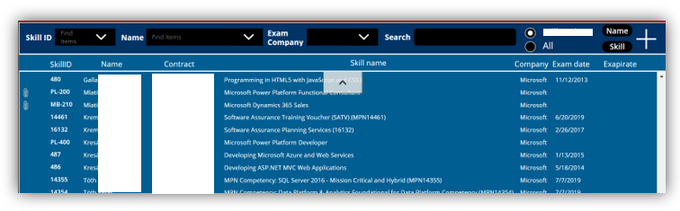
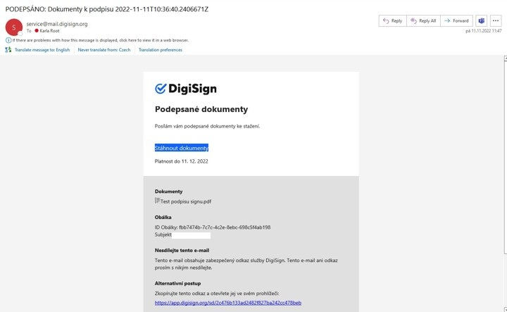

# Enterprise Automation Projects

Portfolio interních podnikových aplikací vytvořených pomocí technologií Microsoft SharePoint, Power Apps, Power Automate a Nintex. Projekty ukazují analýzu požadavků, návrh datového modelu, vývoj uživatelského rozhraní, správu dat a automatizaci podnikových procesů.

> Dokumentace byla anonymizována pro účely portfolia. Osobní údaje, interní adresy, identifikátory a názvy organizací nejsou zveřejněny.

## Projekty

| Projekt | Technologie | Zaměření | Dokumentace |
|---|---|---|---|
| [PoolCar](PoolCar/) | SharePoint 2016, Nintex Forms, Nintex Workflow | Rezervace služebních vozidel | [Případová studie](PoolCar/) · [Dokumentace](PoolCar/Dokumentace/) · [Analýza](PoolCar/Analyza/) |
| [Certifikace](Certifikace/) | Microsoft Power Apps, SharePoint Online | Evidence zaměstnaneckých certifikací | [Dokumentace](Certifikace/Dokumentace/) |
| [Digitální podpis](Digitalni-podpis/) | Power Automate, SharePoint Online, DigiSign API | Elektronické podepisování dokumentů | [Případová studie](Digitalni-podpis/) |

## Ukázky projektů

### Certifikace zaměstnanců (Power Apps)

Ukázka aplikace pro evidenci a správu zaměstnaneckých certifikací.



[Další ukázky a dokumentace projektu Certifikace](Certifikace/README.md)

### Digitální podpis (Power Automate a DigiSign)

Ukázka procesu elektronického podepisování dokumentů.



[Další ukázky a dokumentace projektu Digitální podpis](Digitalni-podpis/README.md)

## Co portfolio ukazuje

- převod business požadavků do funkčního řešení,
- návrh SharePoint seznamů a vazeb mezi daty,
- vývoj interních aplikací a formulářů,
- filtrování, validace a řízení přístupu,
- workflow, API integrace a automatizaci procesů,
- technickou a uživatelskou dokumentaci.

## Použité technologie

- Microsoft Power Apps
- Microsoft Power Automate
- SharePoint Online
- SharePoint 2016
- Nintex Forms
- Nintex Workflow
- DigiSign REST API
- Microsoft 365

## Struktura repozitáře

```text
Automation/
├── README.md
├── PoolCar/
│   ├── README.md
│   ├── Dokumentace/
│   └── Analyza/
├── Certifikace/
│   ├── README.md
│   ├── Dokumentace/
│   └── Images/
└── Digitalni-podpis/
    ├── README.md
    └── Images/
```

## Ochrana informací

Funkční principy, architektura a datové modely zůstávají zachovány. Citlivý obsah byl odstraněn nebo nahrazen anonymizovanými hodnotami.
